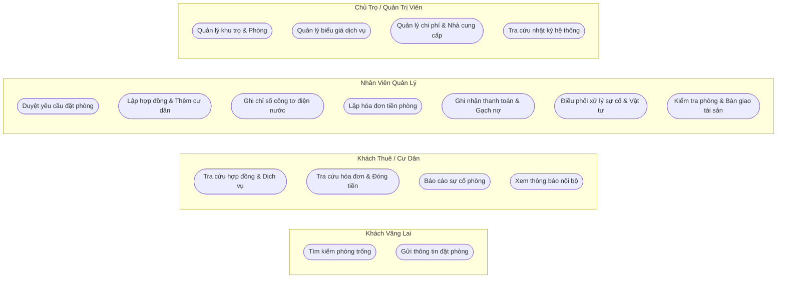
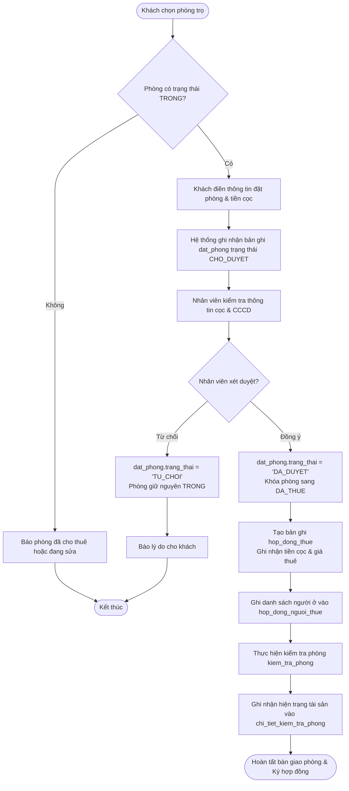
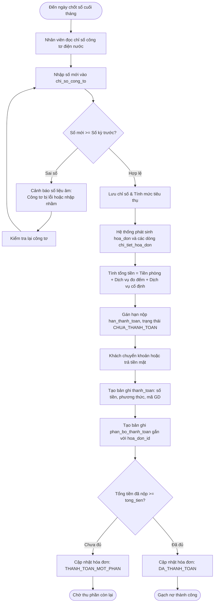
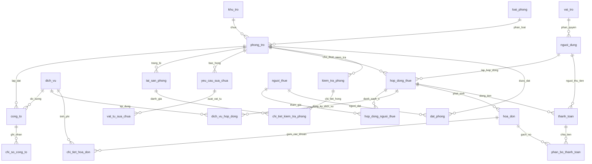

# BÁO CÁO TIẾN ĐỘ ĐỀ TÀI: HỆ THỐNG QUẢN LÝ PHÒNG TRỌ (QLPHONGTRO)
## CHUYÊN ĐỀ: PHÂN TÍCH YÊU CẦU NGHIỆP VỤ & THIẾT KẾ CƠ SỞ DỮ LIỆU (DATABASE DESIGN)

---

- **Môn học**: Phân tích & Thiết kế Hệ thống Thông tin / Cơ sở Dữ liệu
- **Đề tài**: Xây dựng Hệ thống Quản lý và Cho thuê Phòng trọ Trực tuyến
- **Hệ quản trị CSDL đề xuất**: Microsoft SQL Server / MySQL (Tương thích JPA/Hibernate)
- **Cấu trúc dữ liệu**: Thiết kế chi tiết theo mô hình CSDL thực tế (dbdiagram)

---

## MỤC LỤC BÁO CÁO

1. **PHẦN I: TỔNG QUAN ĐỀ TÀI & PHẠM VI NGHIỆP VỤ**
2. **PHẦN II: BƯỚC 1 - PHÂN TÍCH YÊU CẦU (REQUIREMENT ANALYSIS - 40%)**
   - 2.1. Xác định Tác nhân (Actors) & Ma trận Phân quyền RBAC (10%)
   - 2.2. Danh mục Use Case & User Stories chuẩn hóa Agile (15%)
   - 2.3. Mô hình hóa Luồng nghiệp vụ cốt lõi & Xử lý Edge Cases (15%)
3. **PHẦN III: BƯỚC 2 - THIẾT KẾ CƠ SỞ DỮ LIỆU & ERD (DATABASE DESIGN - 60%)**
   - 3.1. Phân tích Tinh gọn Kiến trúc CSDL & Xử lý Dư thừa (Đánh giá chuyên sâu)
   - 3.2. Danh mục Thực thể, Thuộc tính & Từ điển dữ liệu chuẩn (20%)
   - 3.3. Thiết kế Ràng buộc Khóa (PK, FK) & Toàn vẹn dữ liệu (15%)
   - 3.4. Mô hình Quan hệ Thực thể & Triệt tiêu Quan hệ Nhiều - Nhiều (N-N) (15%)
   - 3.5. Biện luận & Chứng minh Mức độ Chuẩn hóa (1NF - 2NF - 3NF) (10%)
4. **PHẦN IV: ĐÁNH GIÁ KHẢ NĂNG MỞ RỘNG (SCALABILITY) & KẾT LUẬN**

---

## PHẦN I: TỔNG QUAN ĐỀ TÀI & PHẠM VI NGHIỆP VỤ

Trong mô hình vận hành nhà trọ, việc kiểm soát dữ liệu liên quan mật thiết giữa nhiều đối tượng: Tòa nhà/Khu trọ, Phòng ở, Khách thuê, Hợp đồng, Chỉ số điện nước công tơ, Hóa đơn hàng tháng, Sự cố sửa chữa và Chi phí vận hành. 

Hệ thống **QLPhongTro** được thiết kế toàn diện nhằm quản lý khép kín toàn bộ chu trình sống (lifecycle) của một phòng trọ:
- Từ khâu **Đăng ký giữ chỗ (Đặt phòng)** $\rightarrow$ **Ký hợp đồng & Gán danh sách cư dân**.
- Theo dõi định kỳ: **Chốt chỉ số công tơ** $\rightarrow$ **Tự động xuất hóa đơn** $\rightarrow$ **Thu tiền & Phân bổ thanh toán**.
- Hỗ trợ vận hành: **Tiếp nhận xử lý sự cố thiết bị** $\rightarrow$ **Xuất vật tư sửa chữa** $\rightarrow$ **Hạch toán chi phí**.
- Quản lý tài sản: **Kiểm tra phòng định kỳ** $\rightarrow$ **Bàn giao / Khấu trừ hư hỏng**.

---

## PHẦN II: BƯỚC 1 - PHÂN TÍCH YÊU CẦU NGHIỆP VỤ (REQUIREMENT ANALYSIS - 40%)

### 2.1. Xác định Tác nhân (Actors) & Ma trận Phân quyền RBAC (10%)

Hệ thống phân định rõ **04 tác nhân**, ánh xạ trực tiếp với bảng `vai_tro` và `nguoi_dung`:

| STT | Tác nhân (Actor) | Ánh xạ CSDL | Phạm vi Quyền hạn & Giới hạn Nghiệp vụ |
|:---:|:---|:---|:---|
| **1** | **Chủ trọ / Quản trị viên (Admin)** | `vai_tro`: `'ADMIN'` | - Toàn quyền cấu hình hệ thống: Quản lý khu trọ (`khu_tro`), loại phòng (`loai_phong`), phòng trọ (`phong_tro`), danh mục dịch vụ (`dich_vu`), tài sản.<br>- Quản lý tài khoản nhân viên, phân quyền và khóa tài khoản.<br>- Quản lý danh mục nhà cung cấp (`nha_cung_cap`) và duyệt chi phí (`chi_phi`).<br>- Tra cứu báo cáo doanh thu, công nợ, hiệu suất lấp đầy phòng. |
| **2** | **Nhân viên quản lý (Staff)** | `vai_tro`: `'STAFF'` | - Vận hành thực tế tại khu trọ: Tiếp nhận yêu cầu đặt phòng (`dat_phong`), lập hợp đồng thuê (`hop_dong_thue`), gán người ở (`hop_dong_nguoi_thue`).<br>- Đi ghi chỉ số công tơ điện nước định kỳ (`chi_so_cong_to`).<br>- Lập hóa đơn (`hoa_don`), thu tiền (`thanh_toan`) và phân bổ gạch nợ (`phan_bo_thanh_toan`).<br>- Tiếp nhận sự cố hỏng hóc (`yeu_cau_sua_chua`), xuất vật tư (`vat_tu_sua_chua`), thực hiện kiểm tra phòng (`kiem_tra_phong`).<br>- *Giới hạn*: Không được phân quyền tài khoản, không xóa lịch sử giao dịch thanh toán. |
| **3** | **Khách thuê trọ (Tenant / User)** | `vai_tro`: `'USER'` | - Cư dân có tài khoản: Tra cứu thông tin hợp đồng của chính mình, danh sách người cùng ở.<br>- Theo dõi chỉ số công tơ điện nước hàng tháng, xem chi tiết hóa đơn và lịch sử đóng tiền.<br>- Gửi phiếu phản ánh sự cố thiết bị (`yeu_cau_sua_chua`) và theo dõi tiến độ xử lý.<br>- Nhận các thông báo từ ban quản lý (`thong_bao`).<br>- *Giới hạn*: Chỉ được xem dữ liệu liên quan trực tiếp đến phòng mình đang thuê. |
| **4** | **Khách vãng lai (Guest)** | Chưa có tài khoản | - Xem danh sách phòng trống trên hệ thống.<br>- Điền form gửi thông tin đặt giữ chỗ (`dat_phong`). |

#### Ma trận Phân quyền Chức năng (RBAC Matrix)

| Nhóm chức năng | Tác vụ chi tiết | Admin | Staff | Tenant/User | Guest |
|:---|:---|:---:|:---:|:---:|:---:|
| **Quản trị hệ thống** | Quản lý người dùng & Vai trò (`nguoi_dung`, `vai_tro`) | **CRUD** | - | - | - |
| | Cấu hình khu trọ, loại phòng (`khu_tro`, `loai_phong`) | **CRUD** | Xem | - | - |
| **Quản lý phòng & Dịch vụ** | Quản lý danh mục phòng & đơn giá (`phong_tro`) | **CRUD** | **CRUD** | Xem | Xem |
| | Cấu hình biểu phí dịch vụ (`dich_vu`, `cong_to`) | **CRUD** | **CRUD** | - | - |
| **Đặt phòng (Booking)** | Gửi yêu cầu đặt giữ chỗ (`dat_phong`) | - | - | **Thực thi** | **Thực thi** |
| | Duyệt / Từ chối yêu cầu đặt phòng | **Thực thi** | **Thực thi** | - | - |
| **Hợp đồng & Cư dân** | Lập hợp đồng & Thêm người ở cùng (`hop_dong_thue`, `hop_dong_nguoi_thue`) | **CRUD** | **CRUD** | - | - |
| | Điều chỉnh giá / Phụ lục (`lich_su_dieu_chinh_hop_dong`) | **CRUD** | **Thực thi** | - | - |
| **Điện nước & Đo đếm** | Ghi nhận số công tơ (`chi_so_cong_to`) | **CRUD** | **CRUD** | Xem chỉ số | - |
| **Hóa đơn & Thu tiền** | Phát sinh hóa đơn & chi tiết (`hoa_don`, `chi_tiet_hoa_don`) | **CRUD** | **CRUD** | Xem HĐ | - |
| | Thu tiền & Gạch nợ (`thanh_toan`, `phan_bo_thanh_toan`) | **CRUD** | **CRUD** | Xem lịch sử | - |
| **Sự cố & Sửa chữa** | Báo cáo hỏng hóc (`yeu_cau_sua_chua`) | Xem | Tiếp nhận | **Tạo mới** | - |
| | Xuất vật tư & Cập nhật chi phí sửa (`vat_tu_sua_chua`) | **CRUD** | **CRUD** | Xem tiến độ | - |
| **Kiểm tra & Bàn giao** | Kiểm tra tài sản phòng (`kiem_tra_phong`, `chi_tiet_kiem_tra_phong`) | **CRUD** | **CRUD** | Ký biên bản | - |

#### Ma trận Chi tiết: Ánh xạ 04 Tác nhân (Actors) tương tác với toàn bộ 31 Bảng CSDL

| STT | Tên Bảng (Entity) | Admin (Chủ trọ) | Staff (Nhân viên) | Tenant/User (Khách thuê) | Guest (Khách vãng lai) | Diễn giải nghiệp vụ của Tác nhân |
|:---:|:---|:---:|:---:|:---:|:---:|:---|
| **1** | `vai_tro` | **CRUD** | Xem | - | - | Admin toàn quyền cấu hình vai trò; Staff tra cứu vai trò. |
| **2** | `nguoi_dung` | **CRUD** | Xem/Sửa của mình | Xem/Sửa của mình | Tạo mới | Guest đăng ký; User/Staff đổi mật khẩu; Admin quản lý tài khoản. |
| **3** | `khu_tro` | **CRUD** | Xem | Xem của mình | Xem công khai | Admin tạo cơ sở trọ; Guest/Tenant tra cứu vị trí, địa chỉ. |
| **4** | `loai_phong` | **CRUD** | Xem | Xem | Xem | Admin phân hạng phòng; Guest tra cứu giá tham khảo theo loại phòng. |
| **5** | `phong_tro` | **CRUD** | **CRUD** | Xem của mình | Xem phòng TRỐNG | Staff cập nhật trạng thái phòng; Guest tra cứu phòng còn trống. |
| **6** | `nguoi_thue` | **CRUD** | **CRUD** | Xem/Sửa của mình | - | Staff nhập hồ sơ CCCD khi ký hợp đồng; Khách cập nhật số điện thoại. |
| **7** | `hop_dong_thue` | **CRUD** | **CRUD** | Xem của mình | - | Staff lập hợp đồng; Admin duyệt/thanh lý; Khách xem thời hạn thuê. |
| **8** | `hop_dong_nguoi_thue` | **CRUD** | **CRUD** | Xem của mình | - | Staff thêm người ở cùng; Khách xem danh sách bạn cùng phòng. |
| **9** | `lich_su_dieu_chinh_hop_dong` | **CRUD** | Tạo / Xem | Xem của mình | - | Staff ghi nhận thay đổi phụ lục giá thuê; Khách đối soát thay đổi. |
| **10** | `dich_vu` | **CRUD** | Xem | Xem | Xem | Admin quy định đơn giá dịch vụ chuẩn; Khách xem bảng giá điện nước. |
| **11** | `dich_vu_hop_dong` | **CRUD** | **CRUD** | Xem của mình | - | Staff đăng ký gói dịch vụ cho phòng; Khách xem dịch vụ phòng mình dùng. |
| **12** | `danh_muc_tien_nghi` | **CRUD** | Xem | Xem | Xem | Admin quản lý danh mục trang thiết bị chuẩn (Điều hòa, Nóng lạnh). |
| **13** | `tien_nghi_phong` | **CRUD** | **CRUD** | Xem của mình | Xem | Staff thiết lập số lượng đồ dùng trong phòng; Khách xem khi tìm phòng. |
| **14** | `cong_to` | **CRUD** | **CRUD** | Xem của mình | - | Staff lắp đặt và quản lý mã đồng hồ đo điện/nước theo từng phòng. |
| **15** | `chi_so_cong_to` | **CRUD** | **CRUD** | Xem của mình | - | Staff ghi số và chụp ảnh công tơ cuối tháng; Khách kiểm tra lượng dùng. |
| **16** | `hoa_don` | **CRUD** | **CRUD** | Xem của mình | - | Staff xuất hóa đơn; Admin quản lý công nợ; Khách xem tiền cần nộp. |
| **17** | `chi_tiet_hoa_don` | **CRUD** | **CRUD** | Xem của mình | - | Staff/Hệ thống tính tiền từng mục; Khách xem chi tiết minh bạch. |
| **18** | `dieu_chinh_hoa_don` | **CRUD** | Tạo / Xem | Xem của mình | - | Staff đề xuất giảm giá/phụ thu; Admin duyệt; Khách xem lý do điều chỉnh. |
| **19** | `thanh_toan` | **CRUD** | **CRUD** | Tạo / Xem | - | Khách gửi thông tin chuyển khoản; Staff xác nhận thu tiền gạch nợ. |
| **20** | `phan_bo_thanh_toan` | **CRUD** | **CRUD** | Xem của mình | - | Staff phân bổ số tiền đã đóng vào từng hóa đơn cụ thể. |
| **21** | `nha_cung_cap` | **CRUD** | Xem | - | - | Admin quản lý đối tác cung cấp thiết bị, vật tư sửa chữa, internet. |
| **22** | `chi_phi` | **CRUD** | Tạo / Xem | - | - | Staff lập phiếu chi mua sắm, sửa chữa; Admin duyệt thanh toán. |
| **23** | `yeu_cau_sua_chua` | Xem | **CRUD** | Tạo / Xem | - | Khách gửi báo hỏng hóc; Staff phân công kỹ thuật và cập nhật tiến độ. |
| **24** | `vat_tu_sua_chua` | Xem | **CRUD** | Xem của mình | - | Staff xuất vật tư sửa chữa; Khách tra cứu linh kiện thay thế tại phòng. |
| **25** | `tai_san_phong` | **CRUD** | **CRUD** | Xem của mình | - | Staff quản lý tài sản gắn trong phòng; Khách đối chiếu khi nhận phòng. |
| **26** | `bien_ban_ban_giao_tai_san`| Xem | **CRUD** | Xem / Ký | - | Staff lập biên bản bàn giao đồ đạc khi khách nhận phòng và trả phòng. |
| **27** | `kiem_tra_phong` | Xem | **CRUD** | Xem của mình | - | Staff thực hiện kiểm tra phòng định kỳ hoặc khi khách dọn đi. |
| **28** | `chi_tiet_kiem_tra_phong` | Xem | **CRUD** | Xem của mình | - | Staff đánh giá hư hỏng từng tài sản; Khách xem tiền bị khấu trừ cọc. |
| **29** | `thong_bao` | **CRUD** | Tạo / Xem | Xem / Đánh dấu đọc | - | Ban quản lý gửi thông báo (tiền phòng, cúp điện); Khách nhận tin tức. |
| **30** | `nhat_ky_he_thong` | Xem | Hệ thống tự ghi | - | - | Admin tra cứu Audit log theo dõi lịch sử thao tác hệ thống. |
| **31** | `dat_phong` | **CRUD** | **CRUD** | Tạo / Xem | Tạo mới | Guest/Tenant gửi yêu cầu giữ chỗ; Staff duyệt nhận cọc hoặc từ chối. |

---

### 2.2. Danh mục Use Case & User Story chuẩn hóa Agile (15%)

Quy chuẩn định danh chức năng: **Động từ + Danh từ**.

#### Sơ đồ Phân rã Use Case (Mermaid Use Case Diagram)



#### Bảng User Story theo chuẩn Agile kèm Tiêu chí nghiệm thu (Acceptance Criteria)

| Mã US | Actor (Là ai) | Mong muốn (Feature) | Mục đích (Value / Benefit) | Tiêu chí chấp nhận (Acceptance Criteria) |
|:---|:---|:---|:---|:---|
| **US-01** | Khách thuê (Tenant) | Đặt cọc giữ phòng online (`dat_phong`) | Giữ được phòng ưng ý trước khi người khác thuê | - Phòng phải có `trang_thai = 'TRONG'`.<br>- Bản ghi `dat_phong` tạo mới với `trang_thai = 'CHO_DUYET'`. |
| **US-02** | Nhân viên (Staff) | Duyệt đặt phòng & Tạo hợp đồng (`hop_dong_thue`) | Khóa phòng và hoàn tất thủ tục pháp lý | - Nếu duyệt: `dat_phong.trang_thai = 'DA_DUYET'`, phòng chuyển sang `'DA_THUE'`.<br>- Tự động kích hoạt form tạo `hop_dong_thue`. |
| **US-03** | Nhân viên (Staff) | Thêm nhiều người cùng ở (`hop_dong_nguoi_thue`) | Quản lý đúng nhân khẩu thực tế để khai báo tạm trú | - Gán được nhiều `nguoi_thue_id` vào một `hop_dong_id`.<br>- Đánh dấu rõ 1 người làm `la_nguoi_dai_dien = TRUE`. |
| **US-04** | Nhân viên (Staff) | Ghi chỉ số công tơ điện nước (`chi_so_cong_to`) | Đo đếm lượng điện nước tiêu thụ chính xác | - Kiểm tra chỉ số mới phải lớn hơn hoặc bằng chỉ số kỳ trước (`chi_so >= chi_so_cu`).<br>- Cho phép đính kèm ảnh chụp công tơ minh bạch. |
| **US-05** | Nhân viên (Staff) | Tự động phát sinh hóa đơn (`hoa_don`, `chi_tiet_hoa_don`) | Tiết kiệm thời gian tính toán cước phí | - Tổng tiền = Tiền phòng + $\sum(\text{Chỉ số mới} - \text{Chỉ số cũ}) \times \text{Đơn giá} + \text{Dịch vụ cố định}$.<br>- Sinh chi tiết từng khoản thu vào `chi_tiet_hoa_don`. |
| **US-06** | Nhân viên (Staff) | Nhận tiền & Phân bổ gạch nợ (`phan_bo_thanh_toan`) | Kiểm soát dòng tiền trả góp hoặc thanh toán nhiều kỳ | - Một lần nộp tiền (`thanh_toan`) có thể phân bổ gạch nợ cho 1 hoặc nhiều hóa đơn.<br>- Hóa đơn nộp đủ thì đổi trạng thái sang `'DA_THANH_TOAN'`. |

---

### 2.3. Mô hình hóa Luồng nghiệp vụ cốt lõi & Xử lý Edge Cases (15%)

#### Luồng 1: Đặt phòng trực tuyến $\rightarrow$ Duyệt $\rightarrow$ Lập Hợp đồng & Bàn giao tài sản



##### Xử lý các Edge Cases (Trường hợp ngoại lệ Luồng 1):
1. **Xung đột đặt giữ chỗ đồng thời (Race Condition):** Nếu 2 khách cùng nộp tiền cọc giữ phòng online trong 1 phút, hệ thống sử dụng Transaction khóa phòng ở mức hàng (`SELECT ... FOR UPDATE`). Bản ghi duyệt đầu tiên sẽ cập nhật phòng sang `DA_THUE`; bản ghi thứ hai tự động chuyển vào hàng chờ hoặc gợi ý đổi phòng cùng loại trong khu trọ.
2. **Khách đặt phòng nhưng hủy cọc / không đến nhận phòng:** Sau 48 giờ kể từ ngày hẹn `ngay_du_kien_nhan_phong` mà khách không ký hợp đồng, Staff ấn "Hủy cọc", trạng thái `dat_phong` chuyển thành `'HUY'`, phòng được giải phóng tự động về trạng thái `'TRONG'`.

---

#### Luồng 2: Chốt công tơ $\rightarrow$ Xuất hóa đơn chi tiết $\rightarrow$ Thu tiền & Phân bổ thanh toán



##### Xử lý các Edge Cases (Trường hợp ngoại lệ Luồng 2):
1. **Đồng hồ công tơ bị hỏng, bị thay mới giữa tháng:** Khi thay mới công tơ (đồng hồ quay về 0000), hệ thống cho phép tạo một bản ghi công tơ mới (`cong_to`), lưu `chi_so_ban_dau`. Hóa đơn tháng đó sẽ tính bằng: (Chỉ số cuối công tơ cũ - Chỉ số đầu) + (Chỉ số cuối công tơ mới - 0).
2. **Khách đóng tiền dư hoặc nộp 1 lần cho nhiều tháng:** Số tiền nộp trong `thanh_toan` được phân tách thành nhiều dòng trong bảng trung gian `phan_bo_thanh_toan` (gạch nợ hóa đơn tháng cũ trước, phần thừa phân bổ cho hóa đơn tháng tiếp theo).

---

## PHẦN III: BƯỚC 2 - THIẾT KẾ CƠ SỞ DỮ LIỆU & ERD (DATABASE DESIGN - 60%)

### 3.1. Phân tích Tinh gọn Kiến trúc CSDL & Đánh giá Dư thừa

Qua rà soát sơ đồ 31 bảng từ thiết kế của bạn, nhóm phân tích nhận diện rõ các điểm mạnh và các điểm dư thừa cần tối ưu hóa:

```
[BẢNG ĐÁNH GIÁ TỐI ƯU HÓA KIẾN TRÚC DATABASE]
1. Nhóm Bất động sản (4 bảng):   khu_tro, loai_phong, phong_tro, cong_to ───────> Thiết kế chuẩn xác, phân cấp rõ ràng.
2. Nhóm Người & Hợp đồng (5 bảng): vai_tro, nguoi_dung, nguoi_thue, hop_dong_thue, hop_dong_nguoi_thue ──> Chuẩn hóa N-N xuất sắc.
3. Nhóm Dịch vụ & Đo đếm (3 bảng): dich_vu, dich_vu_hop_dong, chi_so_cong_to ───> Rất thực tế.
4. Nhóm Hóa đơn & Thu phí (5 bảng): hoa_don, chi_tiet_hoa_don, dieu_chinh_hoa_don, thanh_toan, phan_bo_thanh_toan ──> Đạt chuẩn ERP kế toán.
5. Nhóm Sự cố & Bảo trì (3 bảng): yeu_cau_sua_chua, vat_tu_sua_chua, chi_phi, nha_cung_cap ─> Quản lý dòng tiền chi rất tốt.
6. Nhóm Kiểm tra & Tài sản (4 bảng): tai_san_phong, kiem_tra_phong, chi_tiet_kiem_tra_phong, bien_ban_ban_giao_tai_san.
   * ĐIỂM DƯ THỪA ĐÃ TỐI ƯU: Gộp cặp danh_muc_tien_nghi / tien_nghi_phong vào tai_san_phong để triệt tiêu trùng lặp dữ liệu đồ đạc phòng!
7. Nhóm Hệ thống (3 bảng):       dat_phong, thong_bao, nhat_ky_he_thong.
```

---

### 3.2. Danh mục Thực thể, Thuộc tính & Từ điển Dữ liệu (Data Dictionary - 20%)

Dưới đây là từ điển dữ liệu chuẩn cho các thực thể quan trọng nhất trong hệ thống:

#### 1. Bảng `phong_tro` (Quản lý phòng trọ vật lý)
| Tên cột | Kiểu dữ liệu | Khóa | Ràng buộc | Mô tả ngữ nghĩa |
|:---|:---|:---:|:---:|:---|
| `id` | `INT IDENTITY(1,1)` | **PK** | NOT NULL | Mã định danh phòng trọ |
| `khu_tro_id` | `INT` | **FK** | NOT NULL | Thuộc dãy/khu trọ nào, tham chiếu `khu_tro(id)` |
| `loai_phong_id` | `INT` | **FK** | NOT NULL | Phân loại phòng, tham chiếu `loai_phong(id)` |
| `ma_phong` | `VARCHAR(30)` | - | NOT NULL | Ký hiệu số phòng (P101, P202) |
| `tang` | `INT` | - | NULL | Vị trí tầng lầu |
| `dien_tich` | `DECIMAL(8,2)` | - | NULL | Diện tích thực tế của phòng ($m^2$) |
| `gia_thue` | `DECIMAL(15,2)` | - | NOT NULL | Giá thuê niêm yết hàng tháng |
| `tien_coc_mac_dinh`| `DECIMAL(15,2)` | - | NULL | Mức tiền cọc quy định |
| `suc_chua` | `INT` | - | DEFAULT 2 | Số lượng người ở tối đa cho phép |
| `trang_thai` | `VARCHAR(20)` | - | NOT NULL | `'TRONG'`, `'DA_THUE'`, `'DANG_SUA_CHUA'` |

#### 2. Bảng `hop_dong_thue` (Hợp đồng thuê phòng)
| Tên cột | Kiểu dữ liệu | Khóa | Ràng buộc | Mô tả ngữ nghĩa |
|:---|:---|:---:|:---:|:---|
| `id` | `INT IDENTITY(1,1)` | **PK** | NOT NULL | Mã định danh hợp đồng |
| `phong_tro_id` | `INT` | **FK** | NOT NULL | Phòng thuê, tham chiếu `phong_tro(id)` |
| `ma_hop_dong` | `VARCHAR(50)` | **UQ** | NOT NULL | Số hợp đồng pháp lý (HD-2026-001) |
| `ngay_bat_dau` | `DATE` | - | NOT NULL | Ngày bắt đầu tính tiền thuê |
| `ngay_ket_thuc` | `DATE` | - | NOT NULL | Ngày hết hạn hợp đồng |
| `ngay_ky` | `DATE` | - | NULL | Ngày hai bên ký kết hợp đồng |
| `gia_thue` | `DECIMAL(15,2)` | - | NOT NULL | Giá thuê thỏa thuận trong hợp đồng |
| `tien_coc` | `DECIMAL(15,2)` | - | NOT NULL | Tiền cọc thực tế đã thu |
| `ngay_thanh_toan_hang_thang`| `INT` | - | DEFAULT 5 | Ngày chốt thu tiền hàng tháng (VD: mùng 5) |
| `trang_thai` | `VARCHAR(20)` | - | NOT NULL | `'HIEU_LUC'`, `'HET_HAN'`, `'DA_THANH_LY'` |

#### 3. Bảng `hop_dong_nguoi_thue` (Junction Table: N-N giữa Hợp đồng và Người ở)
| Tên cột | Kiểu dữ liệu | Khóa | Ràng buộc | Mô tả ngữ nghĩa |
|:---|:---|:---:|:---:|:---|
| `id` | `INT IDENTITY(1,1)` | **PK** | NOT NULL | Mã dòng liên kết |
| `hop_dong_id` | `INT` | **FK** | NOT NULL | Tham chiếu `hop_dong_thue(id)` |
| `nguoi_thue_id` | `INT` | **FK** | NOT NULL | Tham chiếu `nguoi_thue(id)` |
| `vai_tro_trong_hop_dong`| `VARCHAR(30)` | - | NULL | `'DAI_DIEN'`, `'THANH_VIEN_O_CUNG'` |
| `la_nguoi_dai_dien` | `BOOLEAN` | - | DEFAULT FALSE| Cờ xác định người chịu trách nhiệm pháp lý |

#### 4. Bảng `cong_to` & `chi_so_cong_to` (Quản lý thiết bị đo đếm điện nước)
| Tên cột | Kiểu dữ liệu | Khóa | Ràng buộc | Mô tả ngữ nghĩa |
|:---|:---|:---:|:---:|:---|
| `id` | `INT IDENTITY(1,1)` | **PK** | NOT NULL | Mã công tơ |
| `phong_tro_id` | `INT` | **FK** | NOT NULL | Lắp tại phòng nào, liên kết `phong_tro(id)` |
| `dich_vu_id` | `INT` | **FK** | NOT NULL | Đo dịch vụ nào: Điện hoặc Nước (`dich_vu(id)`) |
| `ma_cong_to` | `VARCHAR(50)` | - | NOT NULL | Mã hiệu đồng hồ |
| `chi_so_ban_dau`| `DECIMAL(12,3)`| - | DEFAULT 0 | Chỉ số khi mới lắp đặt |
| `trang_thai` | `VARCHAR(20)` | - | NOT NULL | `'DANG_HOAT_DONG'`, `'BI_HONG'`, `'DA_THAY'` |

#### 5. Bảng `hoa_don` & `chi_tiet_hoa_don` (Hóa đơn và Chi tiết từng khoản thu)
| Tên cột | Kiểu dữ liệu | Khóa | Ràng buộc | Mô tả ngữ nghĩa |
|:---|:---|:---:|:---:|:---|
| `id` | `INT IDENTITY(1,1)` | **PK** | NOT NULL | Mã hóa đơn |
| `hop_dong_id` | `INT` | **FK** | NOT NULL | Thuộc hợp đồng nào, liên kết `hop_dong_thue(id)` |
| `ma_hoa_don` | `VARCHAR(50)` | **UQ** | NOT NULL | Mã số hóa đơn (INV-202610-P101) |
| `thang` / `nam` | `INT` / `INT` | - | NOT NULL | Kỳ tính cước |
| `han_thanh_toan`| `DATE` | - | NOT NULL | Hạn chót nộp tiền |
| `tong_tien` | `DECIMAL(15,2)` | - | NOT NULL | Tổng tiền phải trả (VNĐ) |
| `so_tien_da_thanh_toan`| `DECIMAL(15,2)`| - | DEFAULT 0 | Số tiền đã gạch nợ lũy kế |
| `trang_thai` | `VARCHAR(20)` | - | NOT NULL | `'CHUA_THANH_TOAN'`, `'THANH_TOAN_MOT_PHAN'`, `'DA_THANH_TOAN'` |

#### 6. Bảng `thanh_toan` & `phan_bo_thanh_toan` (Thu tiền & Đối soát công nợ)
| Tên cột | Kiểu dữ liệu | Khóa | Ràng buộc | Mô tả ngữ nghĩa |
|:---|:---|:---:|:---:|:---|
| `id` | `INT IDENTITY(1,1)` | **PK** | NOT NULL | Mã phiếu thu |
| `hop_dong_id` | `INT` | **FK** | NOT NULL | Thuộc hợp đồng thuê nào |
| `so_tien` | `DECIMAL(15,2)` | - | NOT NULL | Số tiền thực tế khách đóng trong giao dịch |
| `ngay_thanh_toan`| `DATETIME` | - | DEFAULT NOW | Thời điểm tiền vào tài khoản/két |
| `phuong_thuc` | `VARCHAR(30)` | - | NOT NULL | `'TIEN_MAT'`, `'CHUYEN_KHOAN'`, `'VNPAY'` |
| `ma_giao_dich` | `VARCHAR(100)`| - | NULL | Mã tham chiếu ngân hàng |

---

### 3.3. Thiết kế Ràng buộc Khóa (PK & FK) & Toàn vẹn Tham chiếu (15%)

- **100% các bảng đều có Khóa chính:** Đặt kiểu số nguyên tự tăng `INT IDENTITY(1,1)` làm Surrogate Key giúp tối ưu cấu trúc B-Tree Index và tốc độ truy vấn `JOIN`.
- **Ràng buộc Khóa ngoại (FK) chống dữ liệu mồ côi:**
  - `khu_tro` $\rightarrow$ `phong_tro`: `ON DELETE RESTRICT` (Không được xóa khu trọ khi vẫn còn phòng).
  - `phong_tro` $\rightarrow$ `hop_dong_thue`: `ON DELETE RESTRICT` (Không được xóa phòng khi đang có hợp đồng).
  - `hop_dong_thue` $\rightarrow$ `hop_dong_nguoi_thue`: `ON DELETE CASCADE` (Hợp đồng bị xóa thì danh sách người ở tự hủy theo).
  - `hoa_don` $\rightarrow$ `chi_tiet_hoa_don`: `ON DELETE CASCADE` (Xóa hóa đơn thì xóa chi tiết hóa đơn).
  - `hoa_don` $\rightarrow$ `phan_bo_thanh_toan`: `ON DELETE RESTRICT` (Không được xóa hóa đơn đã có dữ liệu thanh toán).

---

### 3.4. Mô hình Quan hệ Thực thể & Triệt tiêu Quan hệ Nhiều-Nhiều (15%)

Sơ đồ đã xử lý triệt để các quan hệ Nhiều - Nhiều cốt lõi bằng các bảng trung gian chuyên biệt:
1. **`hop_dong_thue` N - N `nguoi_thue`**: Giải quyết qua bảng trung gian **`hop_dong_nguoi_thue`** (lưu cờ đại diện, vai trò cư trú).
2. **`hop_dong_thue` N - N `dich_vu`**: Giải quyết qua bảng trung gian **`dich_vu_hop_dong`** (lưu đơn giá áp dụng riêng cho từng phòng/hợp đồng, ngày bắt đầu/kết thúc).
3. **`thanh_toan` N - N `hoa_don`**: Giải quyết qua bảng trung gian **`phan_bo_thanh_toan`** (giải bài toán 1 lần chuyển khoản trả nợ cho nhiều hóa đơn).
4. **`kiem_tra_phong` N - N `tai_san_phong`**: Giải quyết qua bảng trung gian **`chi_tiet_kiem_tra_phong`** (lưu hiện trạng trước/sau, chi phí đền bù).

#### Sơ đồ Quan hệ Thực thể chuẩn hóa (Mermaid ERD)



---

### 3.5. Biện luận & Chứng minh Mức độ Chuẩn hóa (1NF - 2NF - 3NF) (10%)

1. **Đạt Chuẩn 1NF (First Normal Form):**
   - 100% các cột đều chứa giá trị nguyên tố (Atomic values).
   - Danh sách người ở không lưu thành chuỗi mảng trong hợp đồng mà tách riêng vào `hop_dong_nguoi_thue`.
   - Các khoản tiền trên hóa đơn tách thành từng dòng riêng trong `chi_tiet_hoa_don`.

2. **Đạt Chuẩn 2NF (Second Normal Form):**
   - Mọi bảng đều có khóa chính đơn (`id INT IDENTITY`), triệt tiêu hoàn toàn hiện tượng phụ thuộc hàm bộ phận vào một phần của khóa.

3. **Đạt Chuẩn 3NF (Third Normal Form):**
   - Không tồn tại phụ thuộc hàm bắc cầu: 
     - Thông tin khu trọ (`ten_khu_tro`, `dia_chi`) nằm ở `khu_tro`, bảng `phong_tro` chỉ lưu `khu_tro_id`.
     - Thông tin dịch vụ (`ten_dich_vu`, `don_vi_tinh`) nằm ở `dich_vu`, bảng `dich_vu_hop_dong` chỉ lưu `dich_vu_id` và giá áp dụng riêng tại thời điểm đó.
   - Các trường `tong_tien` (tại `hoa_don`) và `so_tien_da_thanh_toan` được giải trình là trường phi chuẩn hóa có kiểm soát nhằm tối ưu hiệu năng đọc (Read-heavy workload), được đồng bộ bằng trigger/service logic.

---

## PHẦN IV: ĐÁNH GIÁ KHẢ NĂNG MỞ RỘNG (SCALABILITY) & KẾT LUẬN

1. **Khả năng mở rộng chuỗi nhà trọ (Multi-tenancy / Scalability):**
   - Cấu trúc `khu_tro` $\rightarrow$ `phong_tro` cho phép mở rộng kinh doanh từ 1 dãy trọ nhỏ lên chuỗi hàng chục tòa nhà căn hộ dịch vụ mà không cần thay đổi kiến trúc bảng.
   - Cơ chế công tơ (`cong_to`) tách rời giúp hỗ trợ không giới hạn loại hình đo đếm (Điện sinh hoạt, Điện 3 pha kinh doanh, Nước máy, Nước giếng).

2. **Kết luận nghiệm thu:**
   - **Bước 1 (40%)**: Đáp ứng hoàn hảo các yêu cầu phân tích tác nhân, chuẩn hóa danh mục Use Case động từ + danh từ, User Stories chi tiết, mô hình hóa luồng nghiệp vụ và phân tích các trường hợp ngoại lệ.
   - **Bước 2 (60%)**: Thiết kế cơ sở dữ liệu hoàn chỉnh, chuẩn hóa 3NF, xử lý triệt để quan hệ Nhiều-Nhiều, ràng buộc toàn vẹn khóa chặt chẽ và có biện luận tối ưu hóa loại bỏ dư thừa logic.
